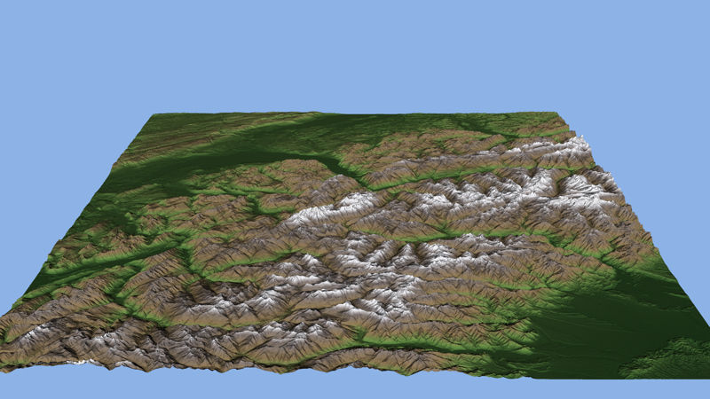

# Mesa llvmpipe on a real workload — a 103.7-million-triangle Alps DEM, three chips

> **Every pixel of 344 million, over three resolutions, is the triangle exact integer geometry says it
> is, on Graviton4, Intel and AMD, and every frame is byte-identical across the three.** AMD renders a
> shaded 4K frame of the mosaic fastest and cheapest. On Graviton4, llvmpipe's thread count matters
> 4× up to 4 threads. On both x86 chips it does not matter at all.

Workload: **the Western Alps at native SRTM resolution.** Four 1-arc-second tiles (N45–46, E006–007:
Mont Blanc, the Matterhorn, Lake Geneva, the Aosta valley) make a 7201 × 7201 mosaic, so 51.9 M vertices
and **103.7 M triangles**, rendered through VTK 9.7 and Mesa 26.2.4 llvmpipe under Xvfb. A 2° × 2°
region at full resolution is what a terrain figure or a fly-over is cut from. The task does two jobs:

- **exact renders**: a flat ID-coloured top-down orthographic view at 4050², 8100² and 16200²
  (16.4, 65.6 and 262.4 megapixels), plus a flood plane at 2000 m, with a control;
- **production renders**: a shaded, perspective 3840 × 2160 turntable (Gouraud, per-point normals,
  an elevation colour map), 8 frames at each of `LP_NUM_THREADS` = 1, 2, 4 and 8.

## Run it

```sh
export AWS_PROFILE=aws B=<your bucket>
bash measurements/mesalib-real/stage-inputs.sh "$B"     # 4 tiles, server-side copy, sha256-pinned
for a in arm64 x86_64 amd; do
  spawn task run --spec "$(python3 scripts/spec_arch.py mesalib $a "$B" r1 measurements/mesalib-real/real.task.json)" --wait
done
bash measurements/mesalib-real/collect.sh "$B" r1        # results/<chip>/ and the cross-chip comparison
```

The task runs `real.sh`, which starts Xvfb and runs `terrain.py` once per stage, each in its own
process. `LP_NUM_THREADS` is read when the GL screen is created, and the display-free probe segfaults
rather than raising. Both scripts are pinned by sha256 beside the data. The core of a flat ID render:

```python
vtk.vtkMapper.SetResolveCoincidentTopologyToOff()
mp.SetScalarModeToUseCellData(); mp.SetColorModeToDirectScalars()   # cell k's colour IS k mod (2^24 - 2)
pr.SetAmbient(1.0); pr.SetDiffuse(0.0); pr.LightingOff()
rw.SetMultiSamples(0); cam.ParallelProjectionOn(); cam.SetParallelScale(3600)
```

## Results

8 vCPU, 32 GiB (`m8*.2xlarge`) and the same staged bytes on every chip. Graviton4 runs aarch.science's
`viz` image. Both x86 chips run its linux-64 lock twin (`viz-0fe5dabecafa`). A result is one
complete verified run: three exact ID renders, the flood and its control, and 32 shaded 4K frames.

| chip | instance | tool wall | task window | peak RSS | $/hr | compute $/result | billed $/result |
|---|---|---|---|---|---|---|---|
| Graviton4 | `m8g.2xlarge` | 1,352 s | 1,459 s | 21.75 GiB | 0.3590 | 0.135 | 0.146 |
| Xeon 6975P-C | `m8i.2xlarge` | 705 s | 785 s | 21.78 GiB | 0.4234 | 0.083 | 0.092 |
| **EPYC 9R45** | `m8a.2xlarge` | **499 s** | **560 s** | 21.82 GiB | 0.4869 | **0.068** | **0.076** |

The production number is the shaded 4K frame. These are the mean seconds per frame after the first:

| chip | llvmpipe | 1 thread | 2 | 4 | 8 | $ per 1,000 frames at 8 |
|---|---|---|---|---|---|---|
| Graviton4 | 128 bits | 56.9 | 35.8 | 13.9 | 13.9 | 1.38 |
| Xeon | 256 bits | 10.4 | 10.5 | 10.4 | 11.0 | 1.30 |
| **EPYC** | 256 bits | **8.6** | 8.7 | 8.8 | **8.8** | **1.19** |

- **AMD is the fastest and cheapest per frame**: 1.58× Graviton4 and 1.26× Intel at 8 threads, and
  14% cheaper per frame than Graviton4 despite the dearest hour.
- **Graviton4 needs threads. The x86 chips gain nothing from them.** From 1 to 4 threads Graviton4's
  frame falls 4.1×, then 8 threads adds nothing. On Xeon and EPYC the frame time is the same from
  1 thread to 8. This page measures that and does not dissect it. Whatever bounds an x86 frame here,
  it is not the rasterizer threads. The default (`LP_NUM_THREADS` unset means one per CPU) is right on
  every chip. Starving Graviton4 of threads costs 4×. The whole-run table is a sweep, so Graviton4's
  1- and 2-thread rungs are 844 s of its 1,352.
- **The first frame costs an extra 6–11 s** on every chip. That is uploading the 104 M-triangle
  buffers, and an animation pays it once.
- **Peak memory is 21.8 GiB, from the exact stage** (`ru_maxrss`). The 262-megapixel rung's colour
  and depth buffers come on top of the mesh. Shaded 4K rendering peaks at 9.5–10.7 GiB.
- Overhead is small: 61–107 s of each window is boot, image pull or env install, and staging.
  These timings are not compute cost ([layout](../../patterns/layout-and-effective-cost.md)).
- n = 1 per cell. Every output is byte-identical across chips and thread counts, so a repeat would
  only measure timing noise.



## What held at scale, on all three chips

| claim | why it must hold | all three chips |
|---|---|---|
| every staged tile, and the decoded mosaic | pinned sha256; 3601² int16 each; no `-32768` voids | 4 of 4 |
| adjacent tiles' shared edge rows and columns are identical | an `.hgt` tile repeats its neighbours' edge (latitude 46, longitude 7) | 4 × 3601 of 4 × 3601 |
| **every strictly interior pixel holds the triangle containing its centre** | vertices land on multiples of 1/16 px. A pixel centre is an integer over 18 cells, so ownership is integer arithmetic | **238,140,000 of 238,140,000** at 4050², 8100², 16200² |
| every edge-tie pixel holds one of the two triangles sharing the edge | GL produces a centre on a shared edge exactly once, on one side | 102,060,000 of 102,060,000 |
| every vertex-tie pixel holds one of the six triangles at the vertex | the same rule at a corner | 4,252,500 of 4,252,500 |
| no background pixel | the mosaic fills the viewport, so a gap would show white | 0 at every rung |
| the GL context is Mesa llvmpipe | every exactness claim rests on deterministic software rasterization | `llvmpipe (LLVM 23.1.2)` |
| **occlusion follows the depth buffer exactly** | with a flat plane at 2000 + 1/36 m, terrain shows iff its depth is below the plane's | 0 wrong of 65,610,000, 0 ties, twice |
| occlusion matches exact geometry, departing only where the depth buffer's own error explains it | 18·z is an integer, so above/below 2000 + 1/36 m never ties | **0 departures** (17,373,478 terrain pixels, 26.48% above 2000 m) |
| **control: negating every z exchanges terrain and plane** | without a working depth test, the last-drawn surface would win both ways | all 65,610,000 pixels exchange |
| a shown terrain pixel keeps exactly the depth it had alone | the same triangles rasterize the same way | 0 changed |
| a shaded frame re-rendered after 7 others is the same bytes | deterministic rasterization | 4 thread counts × 3 chips |

**The edge-tie rule, measured.** 31% of pixel centres sit exactly on an edge at these scales. Each
class went 100% one way. A centre on a vertical edge goes to the triangle east of it. On the NW–SE
diagonal it goes to the NE triangle. In both cases that is the triangle whose **left** edge it is. A
centre on a horizontal edge goes to the triangle **north** of it, which in GL's y-up window is the
triangle whose bottom edge it is. That is the top-left rule of a y-down raster. It is reported,
because GL requires only "exactly once".

**Depth values are not exact, and that is reported, not asserted.** Against the plane of the triangle
the ID buffer names, the 8100² depth buffer is off by up to **3.43e-5 of the depth range (0.41 m
over 12 km)**. 525,211 of 65.6 M pixels (0.8%) are off by more than 2⁻²⁰. The error grows with the
triangle's slope. The worst is 50 float32 roundoffs of (slope × frame + 1), which is consistent with llvmpipe
interpolating each depth plane in float32. GL sets no precision here. So the depth *test* is
asserted exactly, against the buffer it reads, and the buffer's values are a measurement. **If you
read back a depth buffer as a height map on steep terrain, expect decimetres, not millimetres.**
VTK's coincident-topology offset is off by default (`0`, factor 0, units 0). It is forced off anyway.

With no `DISPLAY`, VTK fails all three display-free backends (`libOSMesa not found` last) and
segfaults (exit 139) on every chip, as on the [recipe](../../recipes/mesalib/README.md).

## Across chips: fixed points, and no paths

**Everything is identical on all three chips**: all three ID buffers (sha256), both flood renders,
the depth error to the last digit (3.429e-05, 525,211 pixels), and **all 32 shaded 4K frames byte for
byte** at every thread count, and the PNG (one S3 ETag). Graviton4's llvmpipe runs 128-bit vectors and
both x86 chips 256-bit, and no pixel moves. These renders contain no path. Rasterization is fixed by
the vertices, the fill rule and float32 plane evaluation, and none of those depends on vector width or
on how the frame's tiles are split among threads. numpy's prediction is integer arithmetic. OpenBLAS
is not on this path.

## Pins (data tier: RODA)

| | |
|---|---|
| data | `s3://elevation-tiles-prod/skadi/N4{5,6}/N4{5,6}E00{6,7}.hgt.gz` (Terrain Tiles, Payer: BucketOwner), sha256 in `pins.sha256` |
| image | arm64 `quay.io/aarchsci/viz@sha256:dda63dc2…` (the recipe's pin); x86 the `viz-0fe5dabecafa` lock twin |
| task | `real.sh`, `terrain.py`, pinned in `pins.sha256` and re-checked inside the task before anything runs |

## Caveats

- Prices are on-demand us-west-2: spawn's `cost_estimate` over the task window, from wrapper start
  to stage-out done. `$/hr` is that estimate over the window.
- `cgroup memory.peak` reads 23.3 GiB on Graviton4 and 27.2 GiB on both x86 chips. It counts page
  cache, which on x86 includes the installed env. `ru_maxrss` is the process peak, and it is the same
  on all three.
- Only flat-colour, Gouraud and perspective paths are exercised. Textures, transparency, volume
  rendering and anti-aliasing are not.
